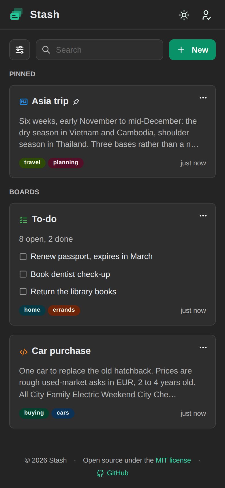
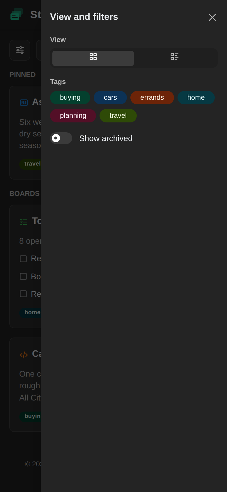
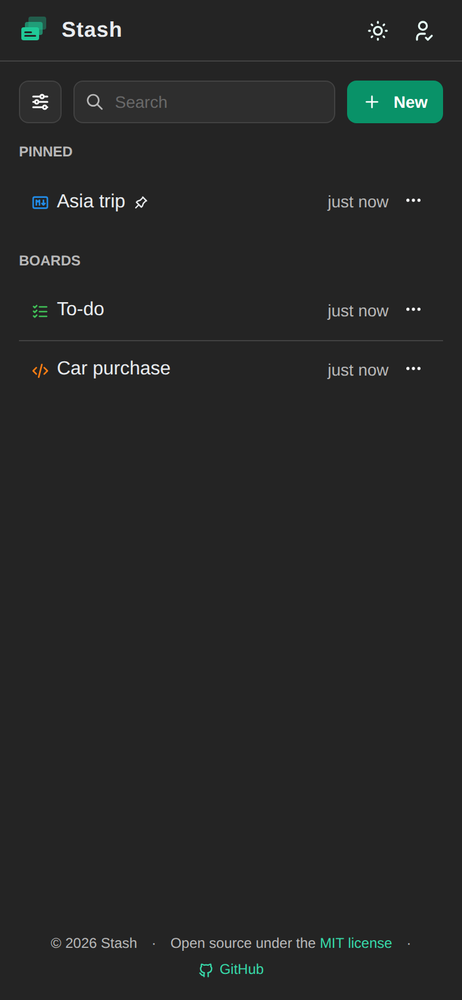
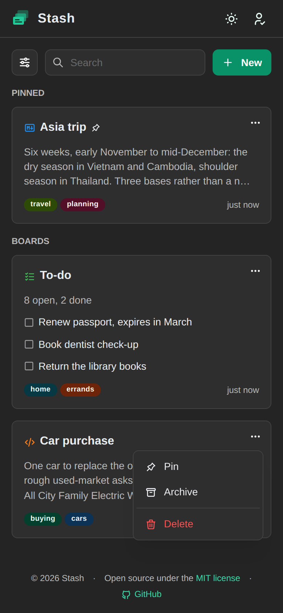
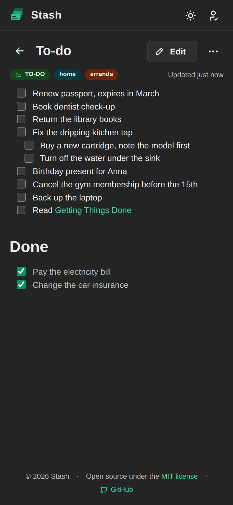
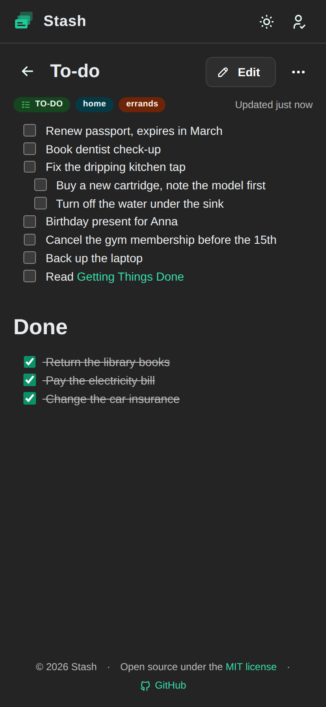
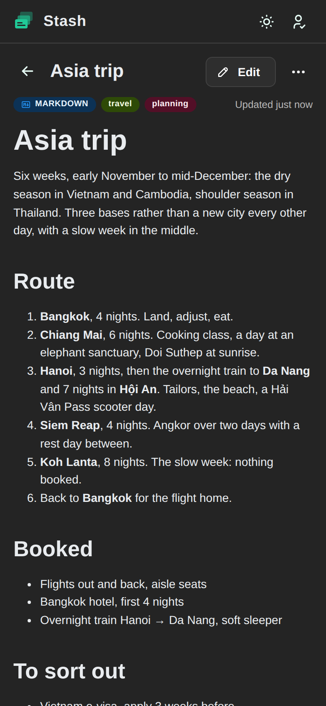
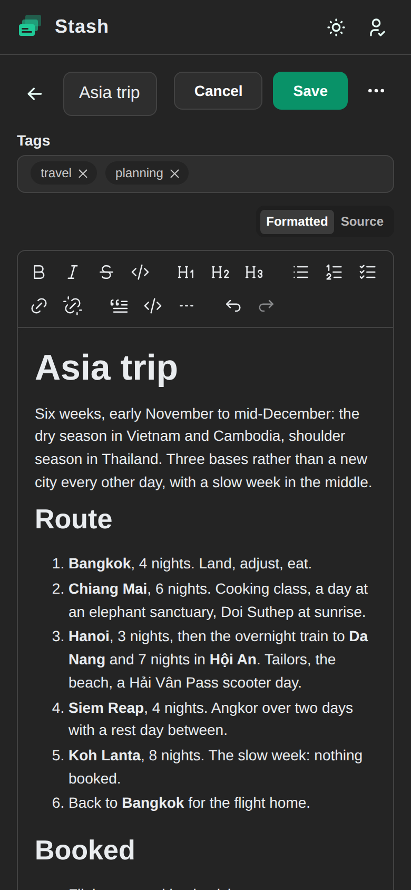
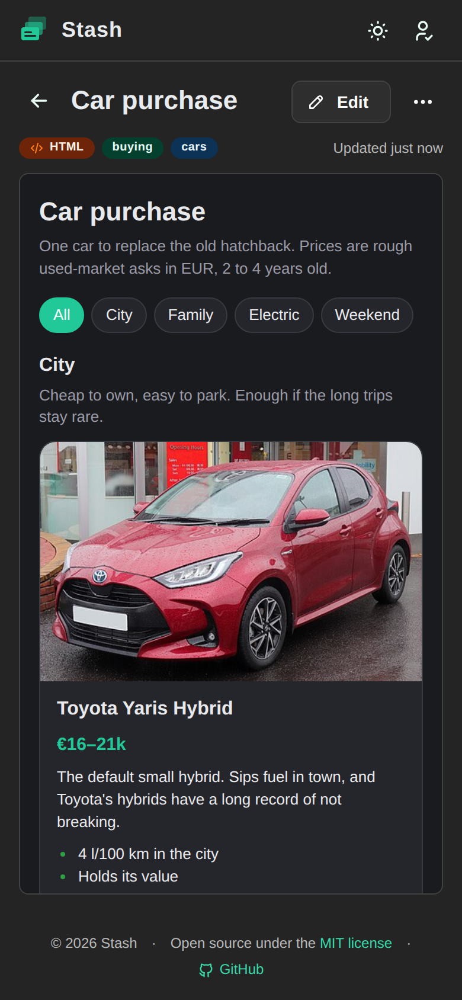

# Stash

Personal notepad: boards for notes, to-do lists and ideas, kept up to date by you and your AI agent.

Tell your agent what is on your mind; it files it on the right board. Open Stash to see what matters next.

## Boards

A board is a page with a title and colour-coded tags. Pinned boards sit on top; archived ones stay out of the way until asked for. The view, the tag filter and the archive switch live behind one button beside the search.

  
  

Boards also show as a list, and each board's menu pins, archives or deletes it.

  
  

### To-do

A Markdown task list. Tick an item and it moves under *Done*; untick it and it comes back. Items may nest, hold links, and be grouped under headings.

  
  

### Markdown

Free-form notes, rendered. Edit the source in place.

  
  

### HTML

A page of your own, rendered in a sandbox: mood boards, comparisons, anything with images, links and a little script.

  

### Sharing

A board's menu shares it: a link that shows the board, read-only, to anyone who has it. Turn sharing off and the link stops working.

## Agents

An agent can sign you up, then reads and writes every board through the REST API with an agent key you make under *Agent keys*. The instructions it needs are served at `/llms.txt`.

## Running it

See [`AGENTS.md`](AGENTS.md) for commands and [`docs/deploy.md`](docs/deploy.md) to deploy your own.
